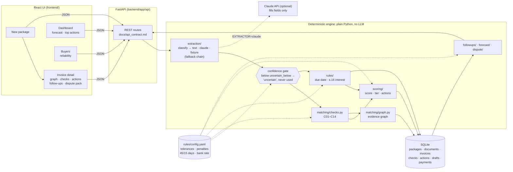

# VyapaarIQ architecture

> One page and one diagram (task T5.11). The detail lives in [`BUILD_SPEC.md`](../BUILD_SPEC.md),
> [`docs/api_contract.md`](api_contract.md) and [`eval/report.md`](../eval/report.md).
> Sources and the decision log: [`docs/references.md`](references.md).
> Demo on synthetic data with fictional companies. Scores are illustrative and legal figures are
> estimates, not legal advice.

## The problem

An Indian MSME supplier sells on credit and often waits well past the due date. When a buyer
delays or disputes a payment, the supplier has to prove three things: the goods were ordered,
they were delivered, and they were accepted. The proof is scattered across PDFs, WhatsApp and
Excel. Worse, the supplier only learns which invoices are weak once they are already overdue.
The MSMED Act gives micro and small suppliers a statutory due date (at most 45 days from
acceptance; 15 days without written terms) and compound interest at 3× the RBI bank rate, but
both depend on the same documents.

## The solution

Upload one invoice's package (invoice, PO, challan, e-way bill, GRN). VyapaarIQ:

1. reads each document into fields that each carry a confidence,
2. cross-checks them (14 checks, C01–C14),
3. draws an **evidence graph** that shows which link is missing or broken,
4. computes the **estimated due date** and statutory interest, showing the rule it used,
5. scores **payment readiness** and lists the **next actions** in order,
6. drafts follow-ups (never sends them), forecasts cash at risk, and exports a
   **dispute evidence pack** for the MSME ODR route (verify before use).

## Diagram

## How a package flows

| Step | Module | What happens |
|---|---|---|
| Upload | `api/routes.py`, `services.create_package` | Validate type, size and emptiness; store the files locally; classify each one (first-page keywords, then filename, or the user's choice) |
| Extract | `extraction/` | `EXTRACTOR=text` (PyMuPDF + regex), `claude` (optional, needs an API key) or `fixture` (ground truth). Falls back `claude → text → fixture` and flags `fallback` ("demo fallback" badge). Every field carries `value · confidence · source_page` |
| Gate | `pipeline.known_value`, `checks.state` | A field below `extraction.uncertain_below` (0.60) makes the checks that depend on it `uncertain`. It is never used in a calculation, never stored as fact, and never used to create a buyer |
| Check | `matching/checks.py` | C01–C14, each returning a status, severity, detail and evidence refs. Tolerances come from config |
| Rules | `rules/due_date.py`, `rules/interest.py` | Acceptance from GRN, then challan received date, then *deemed*. Due = acceptance + min(terms, 45), or +15 without written terms (micro/small only). Interest is compounded monthly at 3× the bank rate. Every result carries its reasoning and the label *estimated* |
| Score | `scoring/` | 100 − penalties (config) → Low / Medium / High tier. Actions are ranked by severity, then deadline |
| Store | `services.process_package` → SQLite | Analysis JSON plus rows for checks and actions. Processing time is recorded |
| Use | `followups/`, `forecast/`, `dispute/` | Drafts for D−7 … D+25 (friendly or firm, email or WhatsApp), the 30/60-day forecast, and the evidence pack (PDF, with Markdown as the fallback) |

## Design decisions

- **Deterministic first, LLM second.** Every status, score, date and amount comes from plain
  Python. An LLM may only fill extracted fields or rephrase text (`Check.explanation`); it can
  never change a result.
- **Never silently trust a low-confidence value.** The UI shows it in amber as "needs human
  check" or `[to be verified]`. The evaluation measures this: 0 confidently wrong fields.
- **Law is configuration.** The 45/15-day rules, deemed-acceptance offset, bank rate and every
  penalty live in `backend/app/rules/config.yaml` and are marked *verify*. The UI reads its
  thresholds from `/api/health` (it falls back to 0.60 only if an older API omits the key).
- **Explainable output.** Each score lists its penalties, each due date its rule, each interest
  figure its formula, and the forecast its heuristic.
- **Local and simple.** SQLite, local files, no Docker, no auth (out of scope). Documents leave the
  machine only if `EXTRACTOR=claude` is chosen, in which case they go to the Anthropic API for
  extraction. Follow-ups are drafts and are never sent.

## Measured results (synthetic, 28 packages; see `eval/report.md`)

| | `text` extraction | `fixture` (upper bound) |
|---|---|---|
| Fields exactly right | 93.5 % | 100 % |
| **Confidently wrong fields** | **0** | 0 |
| Defect detection precision / recall | 100 % / 88.5 % | 100 % / 100 % |
| Package verdicts: correct / abstained / wrong | 24 / 4 / 0 | 28 / 0 / 0 |
| Due date correct | 27 / 28 | 28 / 28 |
| Median processing time | tens of milliseconds (exact figure in `eval/report.md`; it varies per run) | same |

Every abstention is on a phone-scan-style package: `text` cannot read a scan, so it says so
instead of guessing.

## Limits (honest)

- The numbers are on **synthetic** documents. Real invoices and scans are messier.
- Scans need the `claude` extractor (an API key). Its accuracy is not measured yet.
- The deemed-acceptance rule, the 45/15-day limits, the RBI bank rate and the ODR process must be
  **verified against current law** before real use (they are marked VERIFY in config).
- Buyer reliability uses only the supplier's own history, and the demo history is seeded.
- The product does not predict payment, send messages or file legal references.

## Next steps

Measure the `claude` extractor on scans; accounting-software sync (Tally/Zoho); WhatsApp and email
sending with consent; ODR filing support; multi-user access.
